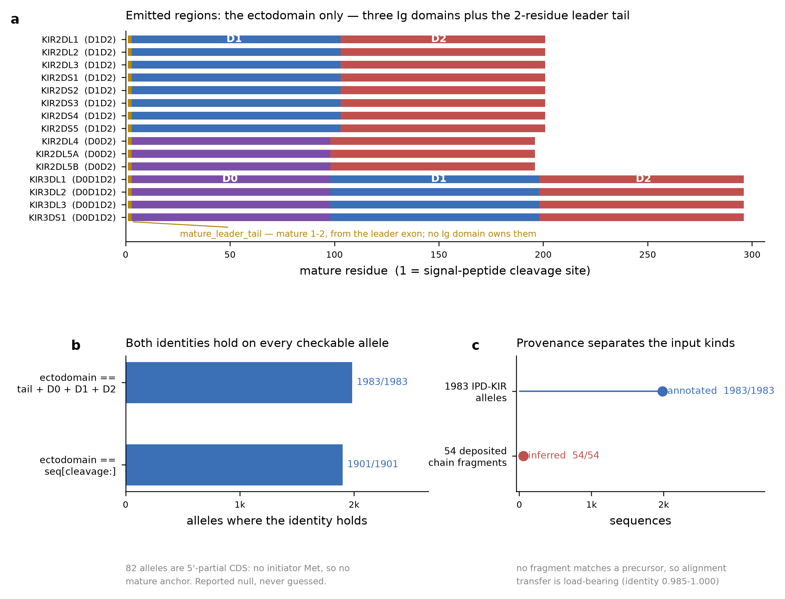

# `chunk` — verification report

`chunk` slices the pMHC-interacting ectodomain out of a KIR sequence column, given the gene.
Every number here comes from a run executed against **this package** — the standalone one, after
the split from `polars_kir_hmm` and after gene calling was removed. Nothing is carried over from
the earlier in-HMM implementation.

Machine-readable: `reports/chunk_verification.json`, `reports/chunk_per_gene.csv`. Figure:
`reports/figures/kir_chunk_verification.png`, regenerated by
`tools/chunk_verification_figure.py`.

**Reproduce:**

```bash
python codegen/vendor_regions.py --kirs-root ..
maturin develop --release                 # never bare `cargo build` (see CLAUDE.md)
pytest tests/test_chunk.py -q             # 27 tests
```

Run against the installed package. `PYTHONPATH=python pytest` shadows the install with a source
tree that has no compiled library beside it and fails 26 / errors 16 on
`FileNotFoundError: no dynamic library found` — a path artefact, not a test defect.

---

## 1. The gene is an input, so there is no gene calling

`chunk(gene=...)` takes the gene from the caller's dataframe. That is the whole reason this
package can exist apart from `polars_kir_hmm`: gene calling was the only part of the original
implementation that needed a trained model. What went with it:

- `type_chain`, `ModelSet`, and the `models`/`hmm`/`npy`/`classify` modules;
- the tie fields `is_tie`, `genes` and `tie_disagreement` — with the gene given there is no tie to
  preserve. A `;`-separated gene value is **refused** with a note rather than arbitrated;
- the `rayon` and `zip` crates, which existed only to load and score models.

`clean_sequence` was the one utility still needed from the classifier module, so it is copied into
`src/sequence.rs` (20 lines of character filtering, no model in it). `tests/test_independence.py`
asserts the separation rather than trusting it: a fresh interpreter must import this package
without pulling in `polars_kir_hmm`, `histo_kir_hmm` or `histo_kir`, and both expressions must run
with those imports actively blocked.

Both paths matter, and which you get depends on the input:

| input | path | measured |
|---|---|---|
| the 1983 IPD-KIR alleles | `annotated` | **1983 / 1983** |
| the 54 deposited chain fragments | `inferred` | **54 / 54** |

No verbatim precursor is ever inferred, and **no deposited fragment ever matches one** — so the
alignment transfer is load-bearing for structural input rather than vestigial.

## 2. Scope: the ectodomain only

Emitted: `leader`, `signal_peptide`, `mature_leader_tail`, `D0`, `D1`, `D2`, `ectodomain`. The
stem, transmembrane helix and cytoplasmic tail are **not** emitted, by scope decision — the
question this package serves is KIR/pMHC recognition and those regions do not participate in it.
They remain in `histo_kir/data/kir_allele_regions.parquet`, unchanged.

**`ectodomain` is D0+D1+D2 (plus the leader's mature tail) and therefore excludes the stem, which
is genuinely extracellular.** It also excludes the 5–7 exon-7 residues N-terminal to the TM helix.
Stated in the field docs so a reader who knows the stem is extracellular can see it was left out
on purpose. For the full extracellular extent use `histo_kir`'s `ectodomain_end`.

**The emitted fields do not tile the precursor** — median shortfall **127 residues** over
expressed complete-CDS alleles, minimum 26. Pinned by
`test_emitted_fields_do_not_tile_the_precursor` so the shortfall reads as intentional. A zero
shortfall is legitimate for exactly one class: **21 alleles, every one of them null**, whose
premature stop falls at or inside D2 so they genuinely have no stem/TM/cyt to omit.

## 3. The two ectodomain identities

`D0 + D1 + D2` is **not** the mature ectodomain — it is 2 residues short, because the leader exon
encodes mature residues 1–2 and they belong to no Ig exon. They are emitted as
`mature_leader_tail`, which puts the offset in the data rather than in a document.

| identity | result |
|---|---|
| `ectodomain == mature_leader_tail + D0 + D1 + D2` | **1983 / 1983** |
| `ectodomain == cleaned[signal_peptide_length : D2_end]` | **1901 / 1901** |
| `ectodomain_ok` column true | **1983 / 1983** |
| per-region lengths equal the parquet's `_length` | **7932 / 7932** comparisons |

The second is the one that catches an off-by-one or a frame error, because it pins the ectodomain
to an absolute offset in the input rather than to the concatenation of its own parts. It is
checkable on 1901 alleles; the other **82** are exactly the 5'-partial CDS entries whose sequence
does not begin at the initiator Met, so mature numbering has no anchor. There
`mature_leader_tail` is null and `ectodomain` begins at the first Ig residue — reported, never
guessed.



Panel **a** is the emitted layout per gene in mature numbering: the three Ig domains and the
2-residue `mature_leader_tail`, with the three architectures visibly distinct (D1D2 has no D0,
D0D2 no D1). Panel **b** is the two identities above. Panel **c** is the provenance split —
every IPD-KIR allele annotated, every deposited fragment inferred, with nothing in between.

## 4. Independent structural cross-checks

Recomputed from `chunk`'s own output against `histo_kir/data/kir_gene_reference.csv`, whose
coordinates are structurally anchored — an exon annotation agreeing with a crystallographic
analysis, not one source restating the other.

| check | result |
|---|---|
| `D2` starts at `histo_kir`'s `hinge_start` (mature 103 / 98 / 198) | **delta 0, 15 / 15 genes** |
| `ectodomain` is a prefix of the structural mature sequence | **15 / 15 genes** |
| `len(ectodomain)` vs `histo_kir`'s `D2_end` | **+1, 15 / 15 genes** |

The +1 is **the shared-codon convention, not an off-by-one.** Exon 5's terminal codon is split
across the exon 5/6 boundary and draws two of its three nucleotides from exon 5, so
`docs/REGIONS.md` §3 assigns that residue to D2 while the structural `stem_start` assigns it to
the stem. Phase 0 recorded the same as `stem_start` delta +1 in all 14 genes with a stem (§7.5).

## 5. Nulls, architecture, and the leader offset

| check | result |
|---|---|
| empty-string region fields (must be 0) | **0** |
| `D0` null (the 8 D1D2 genes) | **866** alleles |
| `D1` null (the 3 D0D2 genes) | **218** alleles |
| `architecture` disagreeing with the parquet | **0 / 1983** |
| alleles whose own architecture differs from their gene's | **6** |
| `leader − signal_peptide == 2` (expressed, complete CDS) | **1853 / 1853**, all 15 genes |

Per gene: **23 / 21** in fourteen genes, **25 / 23** in KIR2DL4. Mature numbering counts from the
cleavage site, so mature-frame work must use `signal_peptide`.

**KIR3DL3 has no missing region** now the stem is out of scope — 0 nulls on the emitted fields,
identical to its three peers:

| gene | expressed complete-CDS alleles | nulls on emitted fields |
|---|---|---|
| KIR3DL1 | 271 | 0 |
| KIR3DL2 | 230 | 0 |
| KIR3DL3 | **195** | **0** |
| KIR3DS1 | 87 | 0 |

## 6. What happens when the supplied gene is unusable

With no classifier, the gene is trusted for the transfer but validated first. Each case is a test:

| supplied gene | behaviour |
|---|---|
| correct | boundaries transferred or read; `provenance` says which |
| **wrong, on an exact sequence match** | **the match wins**, `gene` reports the matched allele's, and a note records that the supplied gene was not used |
| unknown (`KIR9DZ9`) | every field null, `provenance = "none"`, note names the cause |
| null or empty | every field null, `provenance = "none"`, note names the cause |
| a `;`-separated tie set | refused: every field null, note says choose one |
| a non-KIR sequence with a KIR label | **boundaries ARE transferred** — see below |

The last row is this package's honest limit. Given a gene, it transfers that gene's boundaries
onto whatever sequence it is handed; it has no model with which to say "that is not a KIR". LILRB1
labelled as KIR3DL1 therefore produces regions, and **alignment identity is the only signal**. That
signal is usable: measured over all 22 curated negatives given a KIR3DL1 label, identity spans
**0.2039–0.6667**, against
**0.985–1.0** for the 54 real deposited KIR
chains. **The two ranges do not overlap**, so a threshold anywhere between them separates them on
this fixture set — but that is 22 sequences, not a validated cutoff, and a caller who does not
trust its gene column should classify first rather than rely on it.
`test_a_non_kir_sequence_with_a_gene_label_is_still_transferred_but_scores_low` pins the LILRB1
case so it is not mistaken for a bug.

## 7. Shared protein sequences and the cautious merge

892 distinct precursor sequences carry the 1983 allele names; **199** are shared by more than one
name. The vendored table asserts that every shared group agrees on gene, architecture and all 14
boundaries — it does.

But **4 groups disagree on CDS annotation**, because partiality and expression status describe the
*CDS* rather than the protein: three KIR3DL3 groups pair a 5'-partial CDS with sequence-identical
complete ones (a truncated CDS can translate to the same 410-residue protein), and one KIR3DL1
group pairs `KIR3DL1*0150222Q` with 33 sequence-identical expressed siblings. The merge reports the
**cautious** value and names the disagreement in `notes`.

Consequence, measured: the table marks 105 partial alleles, `chunk` reports partial on **130**
allele rows, and **0 alleles are told their CDS is complete when it is not**. The 25 extra are
conservative and visible; the unsafe direction is empty.

## 8. The aligner, and a documented reference bug

The inferred path transfers boundaries through the gapped alignment `histo_kir.numbering` uses.
Transcribing it surfaced a bug in the reference worth recording:

**`histo_kir.numbering._aligner()` does not have free end gaps, despite its docstring.** It sets
`end_insertion_score`/`end_deletion_score` to 0.0 and *then* sets `open_gap_score = -12`; in
Biopython those are aliases that also write the terminal scores, overwriting the zeros. Measured
on the live aligner: `open_end_deletion_score` reads −12.0 after construction.

`src/align.rs` reproduces the aligner **as it behaves**, because that is the configuration under
which the reference's results were validated. The traceback prefers the match state on a score
tie, which is load-bearing: preferring the gap state leaves every score identical while changing
many mappings.

**A limitation to state plainly:** some alleles have equally-optimal alignments that give
different chunk boundaries. The tie-break is deterministic and matches the reference, but on those
sequences the boundary is a choice among equally-scoring alternatives rather than a measurement.
This affects the inferred path only — every IPD-KIR allele takes the annotated path.

## 9. A bug found by moving the package

Making the gene an input surfaced a defect that could not exist in the old design: **a literal
gene arrives as a length-1 column while the sequence column has n rows**, and Polars does not
broadcast a literal for a plugin the way it does for a built-in expression. Reading
`gene_ca.get(row)` directly panicked past row 0, so `chunk(gene="KIR3DL1")` worked on a one-row
frame and crashed on any larger one. Both expressions now clamp the index and reject a gene column
whose height is neither 1 nor `n`. `test_a_literal_gene_and_a_column_agree` pins that both
readings reach the same kernel.

## 10. Test suite

`tests/test_chunk.py` — **27 tests.** `tests/test_independence.py` — **7 tests** asserting the
package stands alone. Full package suite: **55 passed** (these 34 plus the loops track's 21).

`polars_kir_hmm` was returned to its shipped state and re-run: **58 passed**, its pre-split count,
confirming the revert is clean and its `PARITY_REPORT.md` numbers remain true.

Real committed fixtures throughout: the 1983 IPD-KIR alleles, the 54 deposited chains, the 22
curated negatives, and the parquet as normative boundaries. No mocks, no synthetic sequences —
the one non-allele input is a real precursor with its leader and C-terminus sliced off, which is
deposited-style input rather than a fabricated sequence.

`test_region_table_still_tiles` asserts the Phase 0 seven-region invariant against the parquet
directly — `chunk` no longer emits the regions needed to check it, so it is verified where it now
lives. That is what licenses the ectodomain slice: the emitted regions are a prefix of a verified
partition, not an unverified subset.

Throughput: the 1983-allele column chunks in **0.024 s** on the annotated path.
