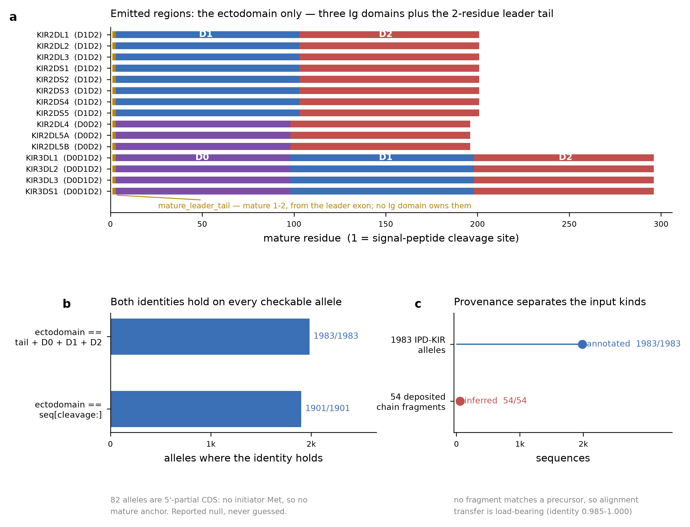
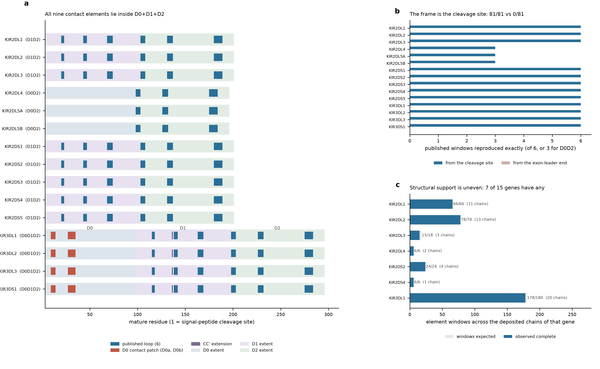

# polars-kir-regions

Two Polars expressions that slice a KIR sequence column into the parts that matter for pMHC
recognition: `chunk` for the ectodomain regions (leader, signal peptide, D0, D1, D2) and `loops`
for the HLA-contacting loops.

**The gene comes from your dataframe.** Both expressions take it as an input; neither infers it.
That is what lets this package stand alone — gene calling is the only part of the problem that
needs a trained model, and it lives in `polars_kir_hmm`. Nothing here imports it, `histo_kir_hmm`
or `histo_kir` at runtime: the region table and loop windows are vendored into the wheel at build
time from `histo_kir`'s Phase 0 outputs.

## Install

```bash
uv add polars-kir-regions
```

From a source checkout, the vendored data has to be generated before the wheel is built:

```bash
python codegen/vendor_regions.py --kirs-root ..
python codegen/vendor_loops.py --kirs-root ..
maturin develop --release      # never bare `cargo build` -- see CLAUDE.md
```

Run the tests against the *installed* package, not the source tree — `PYTHONPATH=python` shadows
the install and the compiled library is not there, which surfaces as 26 failures that are purely a
path artefact:

```bash
maturin develop --release && pytest tests/ -q
```

## Use

```python
import polars as pl
import polars_kir_regions  # noqa: F401  -- registers the .kir_regions namespace

df = pl.DataFrame({"gene": ["KIR3DL1", "KIR2DL1"], "sequence": [seq_a, seq_b]})

out = df.with_columns(r=pl.col("sequence").kir_regions.chunk(gene="gene")).unnest("r")
out.select("gene", "D0", "D1", "D2", "ectodomain", "provenance", "ectodomain_ok")
```

`gene` accepts a column name (`gene="gene"`), a literal (`gene="KIR3DL1"`), or any expression
yielding a String column. A bare string beginning with `KIR` is read as a literal, anything else
as a column name.

One sharp edge worth knowing before you hit it: the returned struct has its own `gene` field, so
`unnest` beside an input column called `gene` raises `DuplicateError`. Rename the input column, or
drop it on the way through:

```python
df.with_columns(r=pl.col("sequence").kir_regions.chunk(gene="gene")).drop("gene").unnest("r")
```

The emitted `gene` is not always the one you passed — on an exact allele match it is the *matched*
allele's gene, which is the point of the annotated path.

| expression | returns |
| --- | --- |
| `.kir_regions.chunk(gene=...)` | struct: `leader`, `signal_peptide`, `mature_leader_tail`, `D0`, `D1`, `D2`, `ectodomain`, `gene`, `allele`, `alleles`, `architecture`, `gene_architecture`, `expression_status`, `cds_partial*`, `provenance`, `identity`, `n_mapped`, `length`, `ectodomain_ok`, `notes` |
| `.kir_regions.loops(gene=...)` | struct: `gene`, `architecture`, `provenance`, `identity`, `n_mapped`, one named field per element, `elements` (list), `notes` |

```python
from polars_kir_regions import chunk, loops, genes, region_dir, loop_dir

df.with_columns(chunk("sequence", gene="gene"))
genes()   # the 15 genes, with architecture, reference allele and signal-peptide length
```

## Five things about the output that are contract

**1. The emitted fields do not tile the precursor.** `chunk` stops at the D2 end, so
concatenating its regions gives a sequence short by the stem, transmembrane helix and cytoplasmic
tail — a median 127 residues. That is a scope decision: this package serves KIR/pMHC recognition
and those regions do not participate in it. For a full-length partition read
`histo_kir/data/kir_allele_regions.parquet`, which does tile (verified 1983/1983 alleles) and is
unchanged by this package.

**2. `ectodomain` excludes the stem, which is genuinely extracellular.** It is
`mature_leader_tail + D0 + D1 + D2`, so it also excludes the 5–7 exon-7 residues N-terminal to the
TM helix. Deliberate, not an error. For the full extracellular extent use `histo_kir`'s
`ectodomain_end`.

**3. `leader` and `signal_peptide` differ by 2 residues** — 23 versus 21 in fourteen genes, 25
versus 23 in KIR2DL4. Mature numbering counts from the *cleavage site*, so mature-frame work (the
loop windows, for instance) must use `signal_peptide`; using `leader` shifts every mature position
by 2. The two residues between them are emitted as `mature_leader_tail`, which puts the offset in
the data rather than in a document. Hence the two identities `chunk` asserts per row and reports
as `ectodomain_ok`:

```
ectodomain == mature_leader_tail + D0 + D1 + D2
ectodomain == cleaned[signal_peptide_length : D2_end]      # where the cleavage site is present
```

**4. Absent regions are null, never `""`.** `D0` for the eight D1D2 genes, `D1` for the three
D0D2 genes. An empty string would claim the region exists and is zero residues long, which is a
different and false statement. With the stem out of scope, KIR3DL3 has no missing region — its D2
runs to the ectodomain end.

**5. An unknown or null gene gives a null row**, with `provenance = "none"` and a note. Nothing
is guessed, and a `;`-separated tie set is refused rather than arbitrated:

```python
# WRONG -- picks a gene the sequence cannot distinguish
df.with_columns(chunk("sequence", gene=pl.col("genes").list.first()))

# right -- decide explicitly, or slice once per candidate and compare
df.filter(~pl.col("is_tie")).with_columns(chunk("sequence", gene="gene"))
```

## Provenance

`provenance` distinguishes a boundary that was *read* from one that was *transferred*:

* **`annotated`** — the cleaned sequence is byte-identical to a known IPD-KIR precursor, so the
  boundaries are that allele's own annotation. The gene is taken from the match rather than from
  your column, and a disagreement is recorded in `notes`: a byte-identical precursor is stronger
  evidence than a label.
* **`inferred`** — it is not, so boundaries are transferred from your gene's reference allele by
  gapped alignment. Materially less certain: 277 of the 1983 alleles differ in length from their
  gene's reference.
* **`none`** — no usable gene, so every field is null.

Both paths are load-bearing, and which one you get depends on what you feed in. Measured on the
committed fixtures: all 1983 IPD-KIR alleles resolve by exact match, and **0 of the deposited
chain fragments do** — so structural input always takes the alignment transfer.

## Verification

`CHUNK_REPORT.md` and `LOOPS_REPORT.md` record what was measured, with the runs that produced
each number. Headlines, all re-measured against this package:

- both ectodomain identities hold for every allele, and region lengths match the reference table
  exactly;
- `D2` starts at `histo_kir`'s structurally-anchored hinge with **delta 0 in 15/15 genes** — an
  exon annotation agreeing with a crystallographic one;
- loop windows counted from the cleavage site agree with `histo_kir` where the exon leader frame
  does not: **81/81** published windows reproduced from the cleavage site, **0/81** from the exon
  leader end, the two origins differing by exactly 2 in all 15 genes.

For `chunk` (full detail in `CHUNK_REPORT.md`):

| check | denominator | holds |
|---|---|---|
| `ectodomain == mature_leader_tail + D0 + D1 + D2` | 1983 alleles | **1983** |
| `ectodomain == cleaned[signal_peptide_length : D2_end]` | 1901 alleles | **1901** |
| per-region lengths equal the reference table's `_length` | 7932 comparisons | **7932** |
| IPD-KIR alleles taking the `annotated` path | 1983 | **1983** |
| deposited chain fragments taking the `inferred` path | 54 | **54** |

The second identity is the one that catches an off-by-one, because it pins the ectodomain to an
absolute offset in the input rather than to the concatenation of its own parts. It is checkable on
1901 alleles; the other **82** are 5'-partial CDS entries whose sequence does not begin at the
initiator Met, so mature numbering has no anchor — there `mature_leader_tail` is null and
`ectodomain` begins at the first Ig residue, reported rather than guessed.



For `loops` specifically (full detail and commands in `LOOPS_REPORT.md`, every figure re-measured
against this package):

| check | comparisons | identical |
|---|---|---|
| vs `histo_kir`, 1983 IPD-KIR alleles (7 fields per element) | 17847 | **17847** |
| vs `histo_kir`, 54 deposited KIR chains | 486 | **486** |
| vs the deposited coordinates | 373 | **373** |
| shipped aligner vs Biopython `alignment[0]` | 14355 | **14355** |
| elements inside the region their name implies | 93 | **93** |

Zero disagreements in all five. The hinge is wholly inside D2 in 15/15 genes and its first residue
is the exon-junction codon in 15/15. The coordinate check applies the per-chain numbering offset
from `validation/numbering_conventions.csv` — 42 chains at mature numbering, **12 at precursor
(+21)**. Five windows across the chains did not transfer whole and each emits null rather than a
short slice.

Only **7 of the 15** genes have any deposited chain, so the other eight genes' windows are
alignment predictions rather than observations; `loop_windows()` marks them `predicted_only`.



## Layout

```
Cargo.toml                       cdylib named _internal, built by maturin
src/sequence.rs                  clean_sequence -- the only thing lifted from the HMM package
src/align.rs                     affine-gap aligner, transcribed from histo_kir.numbering
src/regions.rs                   the vendored region table + its lookups
src/chunk.rs                     the ectodomain slice: exact-match and alignment-transfer paths
src/loops.rs                     the loop-window transfer
src/expressions.rs               the chunk expression
src/loops_expr.rs                the loops expression
python/polars_kir_regions/       namespace registration, validation, regions/ and loops/ data
codegen/vendor_regions.py        reshapes kir_allele_regions.parquet into regions/regions.json
codegen/vendor_loops.py          reshapes the loop windows into loops/loop_windows.json
tests/                           the identities, nulls, provenance, and parity with histo_kir
CLAUDE.md                        working notes and the invariants that must not regress
```

## Relationship to polars_kir_hmm

Sibling packages, no runtime dependency in either direction. `polars_kir_hmm` answers *what is
this chain?* — it owns the profile HMMs, `classify`, `score` and `domains`. This package answers
*where are its parts?*, given the answer. A pipeline that needs both classifies first and passes
the gene column in; a pipeline that already knows the gene installs only this one.

## Licence

MIT.
